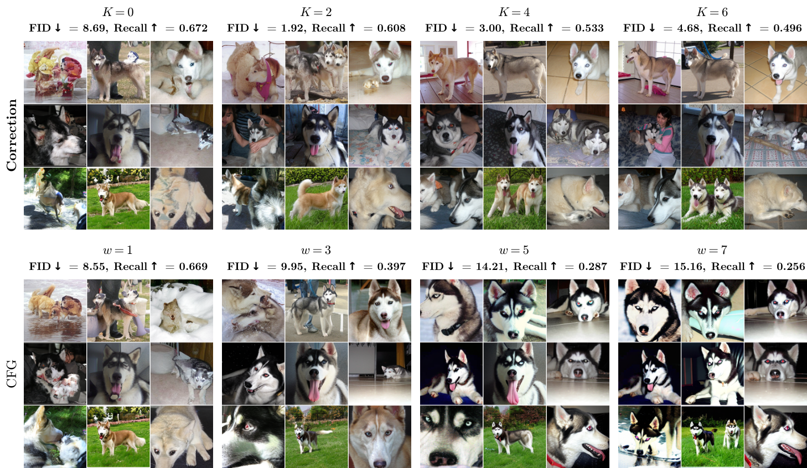

<h1 align="center">Correction Training for Diffusion Models</h1>

<p align="center">
  <a href="https://correction-training.github.io/donghoon/">Donghoon Ahn</a><sup>1</sup> &nbsp;
  <a href="https://raywang4.github.io/">Runqian Wang</a><sup>1</sup> &nbsp;
  <a href="https://people.eecs.berkeley.edu/~efros/">Alexei A. Efros</a><sup>1</sup> &nbsp;
  <a href="https://taesung.me/">Taesung Park</a><sup>2</sup> &nbsp;
  <a href="https://yashbelhe.github.io/">Yash Belhe</a><sup>2</sup>
  <br>
  <sup>1</sup> UC Berkeley &emsp; <sup>2</sup> Reve
</p>

<p align="center">
  <a href="https://correction-training.github.io/paper.pdf"></a>
  <a href="https://correction-training.github.io/"></a>
  <a href="#code-and-checkpoints"></a>
  <a href="https://github.com/sunovivid/correction-training/releases/tag/imagenet-checkpoints-v1"></a>
</p>

<p align="center"><b>No guidance needed.</b></p>

<p align="center">
  Correction achieves <b>2.07 FID with DiT, 1.92 with SiT, and 2.96 with JiT</b><br>
  on class-conditional ImageNet-256, <b>without classifier-free guidance</b>.
</p>

<p align="center">
  
</p>

**Correction training** adds a network that refines the denoiser's prediction using the same clean target. During sampling, we reuse the corrector within each denoising step.

## Method

https://github.com/user-attachments/assets/8969a92a-ced1-4862-a2b1-2dea261bac21

The corrector learns to recover the clean target from the denoiser's prediction, with stop-gradient through that prediction. At inference, its output can be corrected again before constructing the next noisy state.

## Code and checkpoints

**Sampling and training code is coming soon.** ImageNet checkpoints are available
in the [public Release](https://github.com/sunovivid/correction-training/releases/tag/imagenet-checkpoints-v1), with no GitHub login required.

| Name | Model | Updates | Use |
| :--- | :--- | ---: | :--- |
| `jit` | JiT-L/16 | 100K | Evaluation and sampling |
| `sit` | SiT-XL/2 | 100K | Evaluation and sampling |
| `sit-repa-50k` | SiT-REPA-XL/2 | 50K | Main-table evaluation |
| `sit-repa-100k` | SiT-REPA-XL/2 | 100K | Visual sampling |

Download a ready-to-load denoiser–corrector bundle with Python 3.11+:

```bash
git clone https://github.com/sunovivid/correction-training.git
cd correction-training
python src/utils/download.py sit  # Or: jit / sit-repa-50k / sit-repa-100k
```

The downloader saves `config.json` and `model.safetensors` in `checkpoints/NAME/`,
verifies the download automatically, and resumes interrupted transfers.
These are inference and initialization weights; optimizer restart states are
not included. The two SiT-REPA checkpoints share an architecture, with weights
from different training updates.

## ImageNet results

**High-quality generation without CFG.** Correction improves FID over the unguided baselines at approximately the same sampling budget as the CFG references.

| Model | Base FID ↓ | Correction, no CFG ↓ | CFG reference ↓ |
| :--- | ---: | ---: | ---: |
| DiT-XL/2 | 9.58 | **2.07** | 2.51 |
| SiT-XL/2 | 8.55 | **1.92** | 2.11 |
| SiT-REPA-XL/2 | 5.53 | **1.31** | 1.35 |
| JiT-L/16 | 14.86 | **2.96** | 2.35 |

*ImageNet-256, FID@50K, approximately 250 network evaluations per image, including denoiser, corrector, and CFG calls.*

<details>
<summary>Control refinement with K</summary>


Final generations share the same initial noise. The metric curves adjust denoising steps to approximately match compute; more correction is not always better.

</details>

<details>
<summary>More diversity, less oversaturation than strong CFG</summary>



Same class and initial noises. Top: correction without CFG. Bottom: CFG. Correction retains varied poses, framing, backgrounds, and colors.

</details>

## Text-to-image: correction also works with CFG

Correction can reduce oversaturation and repetitive compositions while preserving variety across seeds.


*Same prompt and eight seeds. Top: no correction; bottom: K=6. Left: no CFG; right: CFG (w=6).*

| Setting | GenEval ↑ | DPG-Bench ↑ |
| :--- | ---: | ---: |
| CFG | 68.08 | 83.38 |
| CFG + correction | **70.48** | **83.69** |

*NanoGen-256, w=4, approximately matched sampling budget: 250 vs. 246 network evaluations. The image above uses a separate visual-sampling recipe.*

[More results](docs/results.md) include unguided text-to-image, human preferences, and additional K sweeps. **Text-to-image code is coming soon.**

## Citation

```bibtex
@misc{ahn2026correction,
  title  = {Correction Training for Diffusion Models},
  author = {Ahn, Donghoon and Wang, Runqian and Efros, Alexei A. and Park, Taesung and Belhe, Yash},
  year   = {2026}
}
```

## Acknowledgments

We build on [DiT](https://github.com/facebookresearch/DiT), [SiT](https://github.com/willisma/SiT), [REPA](https://github.com/sihyun-yu/REPA), [LightningDiT](https://github.com/hustvl/LightningDiT), and [JiT](https://github.com/LTH14/JiT).
