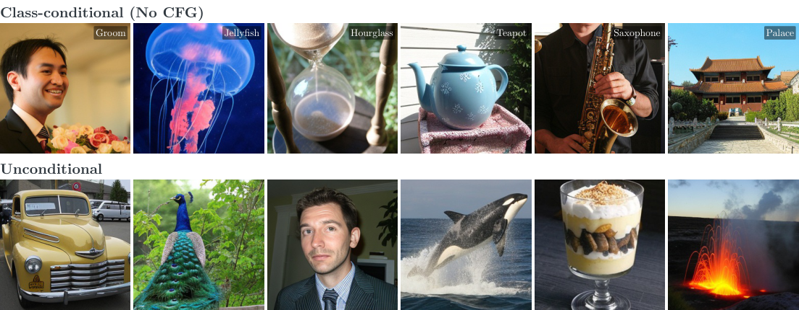
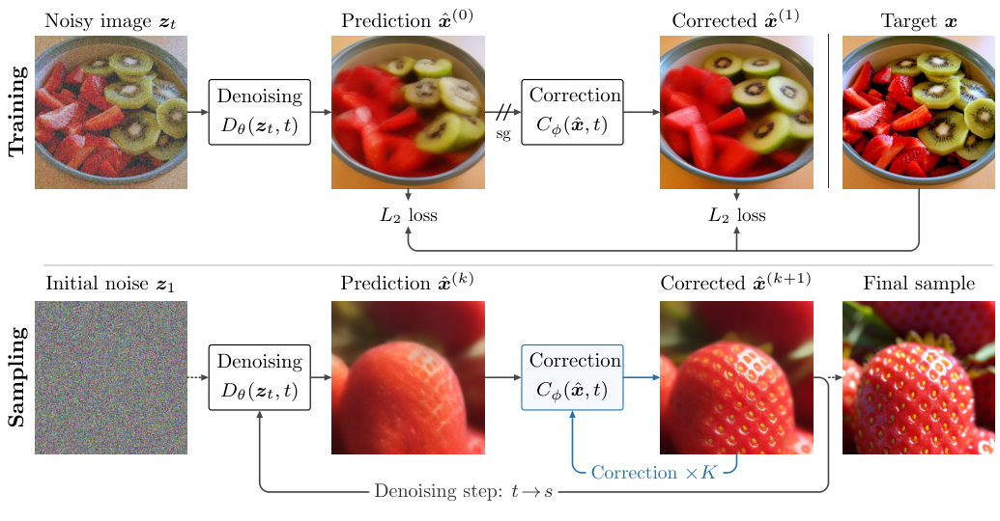
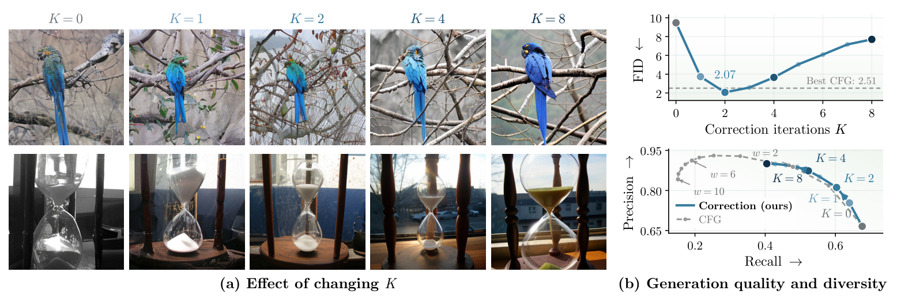
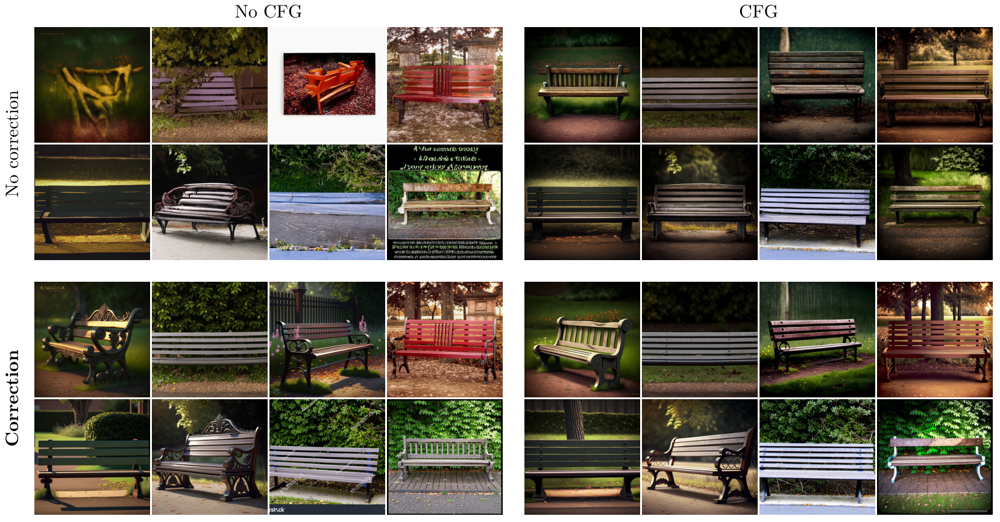

---
# This page is independent from README.md. Edit text, tables and images below.
title: "Correction Training for Diffusion Models"
short-title: "Correction Training"
description: "Correction Training for Diffusion Models. High-quality ImageNet and text-to-image generation without guidance, and more diverse, natural-looking samples with CFG."
social-description: "High-quality diffusion generation without guidance, and more diverse, natural-looking samples with CFG."
site-url: "https://sunovivid.github.io/correction-training/"
social-image: "assets/samples.png"
authors:
  - name: "Donghoon Ahn"
    url: "https://sunovivid.github.io/"
    affiliation: "1"
  - name: "Runqian Wang"
    url: "https://raywang4.github.io/"
    affiliation: "1"
  - name: "Alexei A. Efros"
    url: "https://people.eecs.berkeley.edu/~efros/"
    affiliation: "1"
  - name: "Taesung Park"
    url: "https://taesung.me/"
    affiliation: "2"
  - name: "Yash Belhe"
    url: "https://yashbelhe.github.io/"
    affiliation: "2"
affiliations:
  - id: "1"
    name: "UC Berkeley"
  - id: "2"
    name: "Reve"
navigation:
  - label: "Method"
    href: "#method"
  - label: "ImageNet"
    href: "#imagenet-results"
  - label: "Text-to-image"
    href: "#text-to-image-results"
blog-label: "Blog post"
blog-status: "Coming soon"
resources:
  - label: "Paper PDF"
    href: "paper.pdf"
    primary: true
    pdf: true
  - label: "GitHub"
    note: "Code coming soon"
    href: "https://github.com/sunovivid/correction-training"
    code: true
  - label: "Checkpoints"
    note: "Coming soon"
    disabled: true
    checkpoint: true
---

:::: {.hero}

## No guidance needed.

::: {.hero-result}

Correction achieves **2.07 FID with DiT, 1.92 with SiT, and 2.96 with JiT**\
on class-conditional ImageNet-256, without classifier-free guidance.

:::

{width="1103" height="430"}

::: {.intro}

We train a corrector to refine the denoiser’s prediction using the same clean target. At inference, we reuse the corrector within each denoising step before advancing the sampling trajectory.

:::

::::

:::: {.content-section data-section="Method"}

## Method {#method}

{width="100%"}

<ul>
<!-- <li><strong>Training:</strong> the denoiser predicts from a noisy image; the corrector takes that prediction and learns to recover the same clean target. Correction-loss gradients are stopped at the denoiser's prediction.</li> -->
<!-- <li><strong>Sampling:</strong> denoise once, apply the corrector repeatedly at the same noise level, then use the refined prediction to construct the next noisy state.</li> -->
</ul>

::::

:::: {.content-section data-section="ImageNet results"}

## ImageNet results {#imagenet-results}

**High-quality generation without CFG.** Correction improves FID across DiT, SiT, SiT-REPA, and JiT at approximately the same sampling budget.

| Model         |  Base FID ↓|  Correction, no CFG ↓|  CFG reference ↓|
|:--------------|-----------:|---------------------:|----------------:|
| DiT-XL/2      |        9.58|              **2.07**|             2.51|
| SiT-XL/2      |        8.55|              **1.92**|             2.11|
| SiT-REPA-XL/2 |        5.53|              **1.31**|             1.35|
| JiT-L/16      |       14.86|              **2.96**|             2.35|

*Class-conditional ImageNet-256, FID on 50K samples, approximately 250 network evaluations per image. The budget includes denoiser, corrector, and CFG calls. See the paper for each model's settings.*

### Control refinement with K {#control-refinement-with-k}

Vary the number of corrections per denoising step to change the final sample. The examples below are **complete generations from noise**, with the same initial noise across each row.

{width="100%"}

*Left: SiT-REPA final samples at different K. Right: DiT FID and precision–recall, evaluated on 50K images per setting. Denoising steps are adjusted to keep the total budget approximately fixed; more correction is not always better.*

<details>
<summary>More final-sample K sweeps: SiT, SiT-REPA, and JiT</summary>

{width="100%"}

*Each strip shares its class, initial noise, and denoising grid.*

</details>

### More diversity, less oversaturation than strong CFG {#more-diversity-less-oversaturation-than-strong-cfg}

Increasing CFG can push samples toward similar close-up portraits and oversaturated colors. Correction preserves more varied poses, framings, and backgrounds while producing sharp, coherent images.

{width="100%"}

*Same class and initial noises. Top: increasing correction K without CFG. Bottom: increasing CFG strength w. FID and recall quantify the quality–diversity trade-off.*

::::

:::: {.content-section data-section="Text-to-image results"}

## Text-to-image results {#text-to-image-results}

### Already using CFG? Add correction. {#already-using-cfg-add-correction}

**Correction also works alongside CFG.** It can reduce the “AI slop” look—oversaturated colors, overly stylized appearances, and repetitive compositions—while keeping more variety across seeds.

{width="100%"}

*Prompt: “a photo of a bench.” Each group contains the same eight seeds. Left: no CFG (w = 1); right: CFG (w = 6). Top: no correction; bottom: K = 6. These qualitative examples fix 50 denoising steps, so correction adds inference compute.*

In the paper's human study, **CFG + correction was preferred in 60.75% of quality votes and 60.25% of diversity votes** across 80 prompts. The comparison uses the released baseline with CFG (w = 6) and the correction-trained model with CFG + correction (w = 4, K = 8), with 800 votes per criterion.

### Better prompt alignment, with or without CFG {#better-prompt-alignment-with-or-without-cfg}

| Setting                  |    K|  Network evaluations|  GenEval ↑|  DPG-Bench ↑|
|:-------------------------|----:|--------------------:|----------:|------------:|
| No CFG                   |    0|                  250|      28.30|        70.71|
| No CFG + correction      |    6|                  245|  **50.09**|    **76.82**|
| CFG (w = 4)              |    0|                  250|      68.08|        83.38|
| CFG + correction (w = 4) |    2|                  246|  **70.48**|    **83.69**|

*NanoGen text-to-image model at 256 × 256. The sampling budget is approximately matched: 250 vs. 245 network evaluations without CFG, and 250 vs. 246 with CFG. Guided sampling applies correction before CFG.*

{width="100%"}

::::

:::: {.research-notes}

::: {.eyebrow}

BEHIND THE RESULTS

:::

## Why does repeated correction help?

Matched-denoiser comparisons, prediction trajectories, reconstruction error, and the training–inference gap.

<span class="notes-link blog-soon">Blog post <small>Coming soon</small></span>

::::

:::: {.content-section .compact data-section="Release"}

## Release {#release}

**Code and checkpoints are coming soon.** We will release them in stages, starting with JiT, followed by SiT and SiT-REPA.

| Resource                       | Status                                                                 |
|:-------------------------------|:-----------------------------------------------------------------------|
| Paper                          | [PDF](paper.pdf)                                                       |
| GitHub repository              | [README and results](https://github.com/sunovivid/correction-training) |
| Training and sampling code     | Coming soon                                                            |
| Model checkpoints              | Coming soon                                                            |
| Evaluation scripts and recipes | Coming soon                                                            |

::::

:::: {.content-section .compact data-section="Citation"}

## Citation {#citation}

```bibtex
@misc{ahn2026correction,
  title  = {Correction Training for Diffusion Models},
  author = {Ahn, Donghoon and Wang, Runqian and Efros, Alexei A. and Park, Taesung and Belhe, Yash},
  year   = {2026}
}
```

::::

:::: {.content-section .compact data-section="Acknowledgments"}

## Acknowledgments {#acknowledgments}

Our experiments build on [DiT](https://github.com/facebookresearch/DiT), [SiT](https://github.com/willisma/SiT), [REPA](https://github.com/sihyun-yu/REPA), [LightningDiT](https://github.com/hustvl/LightningDiT), and [JiT](https://github.com/LTH14/JiT). We thank their authors for sharing their code and models.

::::
