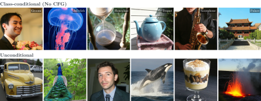
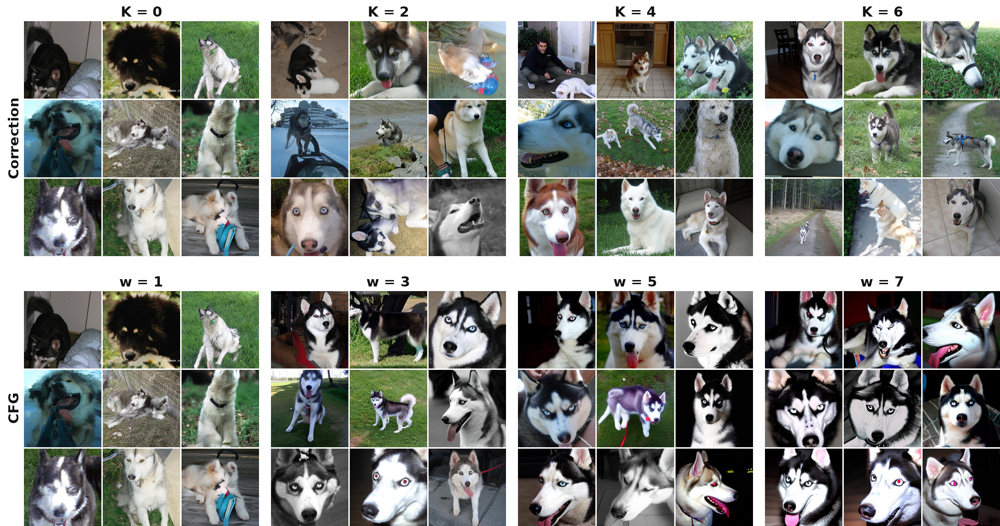

---
# This page is independent from README.md. Edit text, tables and images below.
title: "Correction Training for Diffusion Models"
short-title: "Correction Training"
description: "Correction Training for Diffusion Models. High-quality ImageNet and text-to-image generation without guidance, and more diverse, natural-looking samples with CFG."
social-description: "High-quality diffusion generation without guidance, and more diverse, natural-looking samples with CFG."
site-url: "https://sunovivid.github.io/correction-training/"
social-image: "assets/samples-1280.jpg"
authors:
  - name: "Donghoon Ahn"
    url: "https://sunovivid.github.io/"
    affiliation: "1"
  - name: "Runqian Wang"
    url: "https://raywang4.github.io/"
    affiliation: "1"
  - name: "Alexei A. Efros"
    url: "https://people.eecs.berkeley.edu/~efros/"
    affiliation: "1"
  - name: "Taesung Park"
    url: "https://taesung.me/"
    affiliation: "2"
  - name: "Yash Belhe"
    url: "https://yashbelhe.github.io/"
    affiliation: "2"
affiliations:
  - id: "1"
    name: "UC Berkeley"
  - id: "2"
    name: "Reve"
navigation:
  - label: "Method"
    href: "#method"
  - label: "ImageNet"
    href: "#imagenet-results"
  - label: "Text-to-image"
    href: "#text-to-image-results"
resources:
  - label: "Paper PDF"
    href: "paper.pdf"
    primary: true
    pdf: true
  - label: "GitHub"
    note: "Code coming soon"
    href: "https://github.com/sunovivid/correction-training"
    code: true
  - label: "Checkpoints"
    note: "Coming soon"
    disabled: true
    checkpoint: true
---

:::: {.hero}

## No guidance needed.

::: {.hero-result}

Correction achieves **2.07 FID with DiT, 1.92 with SiT, and 2.96 with JiT**\
on class-conditional ImageNet-256, without classifier-free guidance.

:::
**TL;DR:** We train a corrector that takes the diffusion model's prediction and refines the prediction to make it closer to the same clean target.
At inference, we apply correction multiple times at each denoising step. This simple framework improves the sample quality of diffusion models, yielding results that are better than or competitive with classifier-free guidance.

{width="1103" height="430" mobile-srcset="assets/samples-768.jpg 768w, assets/samples-1280.jpg 1280w"}


::::

:::: {.content-section data-section="Method"}

## Method {#method}

{width="100%"}

<ul>
<strong>Overall framework:</strong> We introduce a corrector that is trained to refine the prediction from the base denoiser to match the same clean target used in the denoising loss (top row). During sampling, we iteratively correct the prediction from the denoiser at each denoising step (bottom row).

</ul>

::::

:::: {.content-section data-section="ImageNet results"}

## ImageNet results {#imagenet-results}

### Improve sample quality with iterative correction {#control-refinement-with-k}

We apply K corrections at every denoising step. Using a larger number of corrections produces significantly higher-quality images, with cleaner structure and artifacts removed from the generated images.

{width="100%"}

*Left: SiT-REPA final samples at different K. Right: DiT FID and precision–recall, evaluated on 50K images per setting.*

### High-quality generation without CFG
Correction improves FID across DiT, SiT, SiT-REPA, and JiT using a sampling budget that is the same as or smaller than that of CFG.

| Model         |  Base FID ↓|  Correction, no CFG ↓|  CFG reference ↓|
|:--------------|-----------:|---------------------:|----------------:|
| DiT-XL/2      |        9.58|              **2.07**|             2.51|
| SiT-XL/2      |        8.55|              **1.92**|             2.11|
| SiT-REPA-XL/2 |        5.53|              **1.31**|             1.35|
| JiT-L/16      |       14.86|              **2.96**|             2.35|

*Class-conditional ImageNet-256, FID on 50K samples, approximately 250 network evaluations per image (including denoiser and corrector calls for correction, and unconditional calls for CFG). We keep the number of network evaluations for correction no larger than that for CFG. See the paper for each model's settings.*


### More diversity, less oversaturation than strong CFG {#more-diversity-less-oversaturation-than-strong-cfg}
Increasing CFG can push samples toward similar close-up portraits and oversaturated colors. Correction preserves more varied poses, framings, and backgrounds while producing sharp, coherent images.

{width="100%" mobile-srcset="assets/imagenet-diversity-repa-768.jpg 768w, assets/imagenet-diversity-repa-1280.jpg 1280w"}

*Same class and initial noises. Top: increasing correction K without CFG. Bottom: increasing CFG strength w. FID and recall quantify the quality–diversity trade-off.*

::::

:::: {.content-section data-section="Text-to-image results"}

## Text-to-image results {#text-to-image-results}

### Already using CFG? Add correction. {#already-using-cfg-add-correction}

**Correction also works alongside CFG.** Correction can reduce the AI look, oversaturated/overcooked colors, and loss of diversity from CFG.

{width="100%"}

*Prompt: “a photo of a bench.” Each group contains the same eight seeds. Left: no CFG (w = 1); right: CFG (w = 6). Top: no correction; bottom: K = 6. These qualitative examples fix 50 denoising steps, so correction adds inference compute.*

In the paper's human study, **CFG + correction was preferred in 60.75% of quality votes and 60.25% of diversity votes**.

### Better prompt alignment, with or without CFG {#better-prompt-alignment-with-or-without-cfg}

| Setting                  |    K|  Network evaluations|  GenEval ↑|  DPG-Bench ↑|
|:-------------------------|----:|--------------------:|----------:|------------:|
| No CFG                   |    0|                  250|      28.30|        70.71|
| No CFG + correction      |    6|                  245|  **50.09**|    **76.82**|
| CFG (w = 4)              |    0|                  250|      68.08|        83.38|
| CFG + correction (w = 4) |    2|                  246|  **70.48**|    **83.69**|

*NanoGen text-to-image model at 256 × 256. The sampling budget is approximately matched: 250 (baseline) vs. 245 network evaluations without CFG (ours), and 250 (baseline) vs. 246 with CFG (ours).*

{width="100%"}

::::

:::: {.research-notes}

::: {.eyebrow}

BEHIND THE RESULTS

:::

## Why does correction help?

Diffusion models often predict structure-collapsed images (if we don't use guidance) because of error accumulation during sampling (so-called "exposure bias"). Correction learns to make predictions sharper and globally coherent, and applying it multiple times can make an incoherent prediction from the base denoiser much sharper and more realistic, which makes the intermediate states more in-distribution with respect to its training distribution, thus resulting in better-quality samples. Please refer to Section 4 (Discussion) of the paper.


::::

:::: {.content-section .compact data-section="Release"}

## Release {#release}

**Code and checkpoints are coming soon.** We will release them in stages, starting with JiT, followed by SiT and SiT-REPA.

| Resource                       | Status                                                                 |
|:-------------------------------|:-----------------------------------------------------------------------|
| Paper                          | [PDF](paper.pdf)                                                       |
| GitHub repository              | [README and results](https://github.com/sunovivid/correction-training) |
| Training and sampling code     | Coming soon                                                            |
| Model checkpoints              | Coming soon                                                            |

::::

:::: {.content-section .compact data-section="Citation"}

## Citation {#citation}

```bibtex
@misc{ahn2026correction,
  title  = {Correction Training for Diffusion Models},
  author = {Ahn, Donghoon and Wang, Runqian and Efros, Alexei A. and Park, Taesung and Belhe, Yash},
  year   = {2026}
}
```

::::

:::: {.content-section .compact data-section="Acknowledgments"}

## Acknowledgments {#acknowledgments}

Our experiments build on [DiT](https://github.com/facebookresearch/DiT), [SiT](https://github.com/willisma/SiT), [REPA](https://github.com/sihyun-yu/REPA), [LightningDiT](https://github.com/hustvl/LightningDiT), and [JiT](https://github.com/LTH14/JiT). We thank their authors for sharing their code and models.

::::
