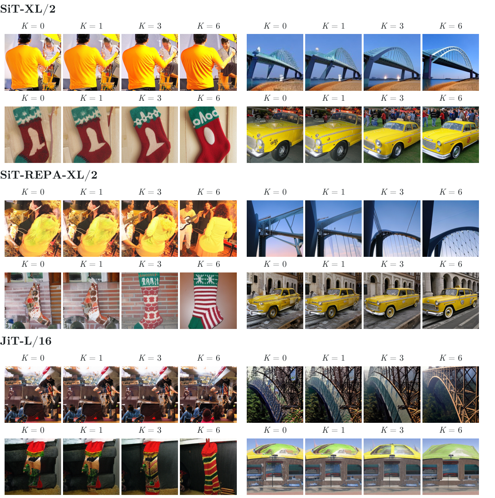
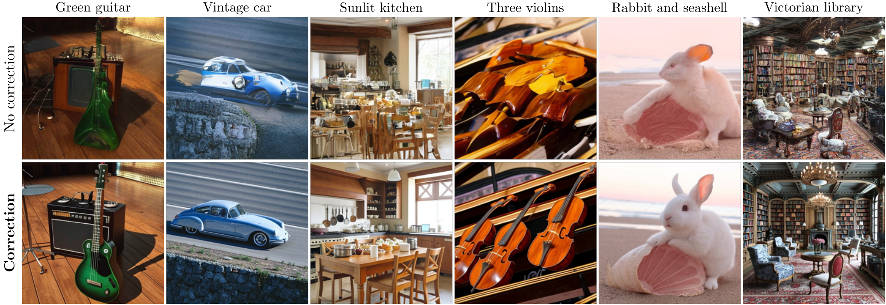

# Additional results

See the [paper](https://sunovivid.github.io/correction-training/paper.pdf) and
[project page](https://sunovivid.github.io/correction-training/) for the full results.
The main [README](../README.md#imagenet-results) contains the ImageNet FID table,
matched-budget K curves, and diversity comparison.

## More ImageNet K sweeps

Each strip shares its class, initial noise, and denoising grid. These examples
keep denoising steps fixed, so more correction adds inference compute.

## Text-to-image prompt alignment

| Setting | K | Network evaluations | GenEval ↑ | DPG-Bench ↑ |
| :--- | ---: | ---: | ---: | ---: |
| No CFG | 0 | 250 | 28.30 | 70.71 |
| No CFG + correction | 6 | 245 | **50.09** | **76.82** |
| CFG (w = 4) | 0 | 250 | 68.08 | 83.38 |
| CFG + correction (w = 4) | 2 | 246 | **70.48** | **83.69** |

NanoGen text-to-image model at 256 × 256. The sampling budget is approximately
matched: 250 vs. 245 network evaluations without CFG, and 250 vs. 246 with CFG.
Guided sampling applies correction before CFG. Scores are percentages.
Text-to-image implementation is not included in this preview.

## Correction alongside CFG

Prompt: “a photo of a bench.” Each group contains the same eight seeds.
Left: no CFG (w=1); right: CFG (w=6). Top: no correction; bottom: K=6.
The image uses 50 denoising steps for every setting, so its compute differs
across correction counts and from the matched-budget table above.

In the paper's human study, CFG + correction was preferred in **60.75% of
quality votes** and **60.25% of diversity votes**, across 80 prompts and 800
votes per criterion. The comparison uses the released baseline with CFG (w=6)
and the correction-trained model with CFG + correction (w=4, K=8).
These study settings differ from the illustrated bench comparison.
